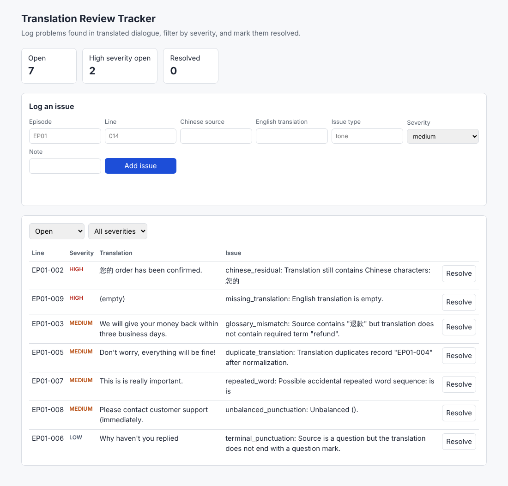

# Translation Review Tracker


A Flask + SQLite web app for tracking problems found in translated dialogue. Reviewers log an issue against a line (episode, line number, Chinese source, English translation), set its severity, and mark it resolved when fixed. A REST API exposes everything, and a small page built on that API makes it usable without Postman.

It connects to my [localization QA checker](https://github.com/rongyuryan/bilingual-ai-localization-qa): the checker's `issues.csv` report can be imported straight into the tracker, so automated findings and human review end up in one queue.



## Run it

```bash
pip install -r requirements.txt
flask --app tracker import-report examples/qa_issues.csv   # optional sample data
flask --app tracker run
```

Open http://127.0.0.1:5000. The database is created at `instance/tracker.sqlite` (override with `TRACKER_DATABASE`).

## API

| Method | Path | Purpose |
| --- | --- | --- |
| GET | `/api/segments?episode=EP01` | List lines with their open-issue count |
| POST | `/api/segments` | Add a line (`episode`, `line_ref`, `source_zh`, optional `translation`); 409 if it exists |
| GET | `/api/segments/<id>` | One line with all its issues |
| PATCH | `/api/segments/<id>` | Update the translation |
| POST | `/api/segments/<id>/issues` | Log an issue (`issue_type`, `severity`: low/medium/high, optional `note`) |
| GET | `/api/issues?status=open&severity=high&episode=EP01` | Filter issues, sorted high → low severity |
| PATCH | `/api/issues/<id>` | Change `status` (open/resolved), `severity` or `note`; resolving records `resolved_at` |
| DELETE | `/api/issues/<id>` | Remove an issue |
| GET | `/api/stats` | Open/resolved totals, open by severity, counts by issue type, open by episode, average hours to resolve |

Errors come back as JSON (`{"error": "Bad Request", "message": "missing required field(s): severity"}`) with status 400, 404 or 409.

A Postman collection with chained requests and response checks is in [`docs/tracker.postman_collection.json`](docs/tracker.postman_collection.json).

## Design

- **Plain SQL, no ORM.** The schema is in [`tracker/schema.sql`](tracker/schema.sql): two tables, a foreign key with `ON DELETE CASCADE`, `CHECK` constraints on severity and status, a unique constraint on `(episode, line_ref)`, and indexes for the common filters. Statistics are computed with `GROUP BY`, `JOIN` and conditional `SUM` queries, and every query is parameterized.
- **Idempotent import.** Re-importing the same QA report creates no duplicate lines or open issues.
- **Vanilla JavaScript front end.** One HTML file that calls the API with `fetch`; user text is inserted with `textContent`, never `innerHTML`.

## Tests

```bash
pip install -r requirements-dev.txt
python -m playwright install chromium
pytest -m "not e2e"   # 22 API, validation, SQL aggregate and import tests
pytest -m e2e         # 4 Playwright browser tests against a live server
```

The browser tests start the app on a free port, fill in the form, resolve issues, use the filters, and check that validation errors appear on the page. GitHub Actions runs both suites on Python 3.10 and 3.12 for every push.

## Project layout

```text
tracker/__init__.py      app factory
tracker/api.py           REST endpoints
tracker/db.py            SQLite connection, CLI commands, CSV import
tracker/schema.sql       tables, constraints, indexes
tracker/static/          web UI
tests/                   pytest API/import tests and Playwright E2E tests
examples/qa_issues.csv   sample report from the QA checker
docs/                    screenshot and Postman collection
```
